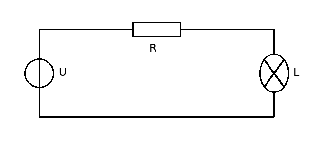

# 1 Grundbegriffe

::seite[1]

Dieses Beispielskript ist frei erfunden. Es zeigt, wie der Lernhelfer ein Skript aufbereitet: Der Originaltext bleibt Wort für Wort stehen, alles Weitere ist als Ergänzung markiert.

## 1.1 Spannung und Strom

Die elektrische Spannung $U$ treibt den elektrischen Strom $I$ durch einen geschlossenen Stromkreis. Ohne Spannung fließt kein Strom.

:::anmerkung[Zur Abbildung 1.1]
Die Quelle links ist eine ideale Spannungsquelle (Kreis mit Strich in Leitungsrichtung). Oben liegt der Widerstand $R$, rechts die Lampe $L$. Der Strom fließt durch alle drei Bauteile nacheinander: Es gibt nur einen Weg, also ist der Strom überall gleich groß. (skript.pdf, S. 1)
:::

:::grafik[Abbildung 1.1 mit Zählpfeilen]
<Schaltung breite={7} hoehe={3}>
  <Spannungsquelle von={[0, 0]} nach={[0, 3]} spannung="U" spannungUmkehren />
  <Widerstand von={[0, 3]} nach={[7, 3]} name="R" strom="I" spannung="U_R" />
  <Lampe von={[7, 3]} nach={[7, 0]} name="L" spannung="U_L" />
  <Leitung punkte={[[7, 0], [0, 0]]} />
</Schaltung>
Die Pfeile sind Zählpfeile: Sie legen fest, in welcher Richtung eine Größe positiv gezählt wird. Hier zeigen Strom und Spannungen am Widerstand und an der Lampe in dieselbe Richtung (Verbraucherzählpfeilsystem).
:::

::seite[2]

## 1.2 Das ohmsche Gesetz

Für einen ohmschen Widerstand ist der Strom proportional zur Spannung:

$$
U = R \cdot I \tag{1.1}
$$

:::variablen
- $U$: Spannung am Widerstand, in Volt (V)
- $R$: Widerstand, in Ohm (Ω)
- $I$: Strom durch den Widerstand, in Ampere (A)
:::

Der Proportionalitätsfaktor $R$ heißt Widerstand:anm[Gemeint ist hier der Wert R, nicht das Bauteil.]. Seine Einheit ist das Ohm, $1\,\Omega = 1\,\mathrm{V}/\mathrm{A}$.

| Größe | Formelzeichen | Einheit |
|---|---|---|
| Spannung | $U$ | Volt (V) |
| Strom | $I$ | Ampere (A) |
| Widerstand | $R$ | Ohm (Ω) |

:::denkanstoss[Gilt Gleichung 1.1 auch für die Lampe aus Abbildung 1.1?]
Nur näherungsweise: Der Glühdraht wird warm, und sein Widerstand steigt mit der Temperatur. $R$ ist dann keine Konstante mehr, die Kennlinie $I(U)$ ist gekrümmt statt gerade.
:::

:::frage[Was passiert mit dem Strom, wenn sich bei gleicher Spannung der Widerstand verdoppelt?]
Er halbiert sich, denn nach Gleichung 1.1 ist $I = U/R$.
:::

:::auswahl[Welche Aussagen über einen ohmschen Widerstand stimmen?]
- [x] Seine Kennlinie $I(U)$ ist eine Gerade durch den Ursprung.
- [ ] Sein Widerstand steigt mit der Spannung.
- [x] Doppelte Spannung bedeutet doppelten Strom.

Bei einem ohmschen Widerstand ist $R$ konstant, deshalb ist $I$ proportional zu $U$.
:::

:::rechnen[An einem Widerstand von $4{,}7\,\mathrm{k\Omega}$ liegen $12\,\mathrm{V}$. Wie groß ist der Strom in mA?]{ergebnis=2.55 toleranz=0.02 einheit="mA"}
$I = U/R = 12\,\mathrm{V} / 4{,}7\,\mathrm{k\Omega} \approx 2{,}55\,\mathrm{mA}$
:::
