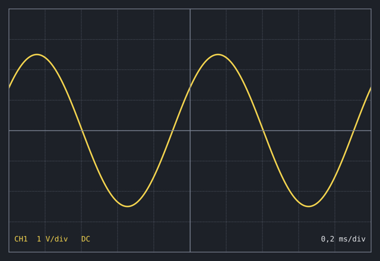

# 2 Das RC-Glied

::seite[3]

Ein Kondensator speichert Ladung. Wird er über einen Widerstand an eine Gleichspannung $U_0$ gelegt, lädt er sich nicht sofort, sondern nach einer Exponentialfunktion auf.

## 2.1 Aufladen

Für die Spannung am Kondensator gilt nach dem Schließen des Schalters

$$
u_C(t) = U_0 \left(1 - e^{-t/\tau}\right) \quad \text{mit} \quad \tau = R C \tag{2.1}
$$

:::variablen
- $u_C(t)$: Spannung am Kondensator zur Zeit $t$, in V
- $U_0$: Spannung der Quelle, in V
- $t$: Zeit seit dem Schließen des Schalters, in s
- $\tau$: Zeitkonstante, in s
- $R$: Widerstand, in Ω
- $C$: Kapazität des Kondensators, in Farad (F)
:::

Nach einer Zeitkonstante ist der Kondensator zu etwa 63 % geladen, nach fünf Zeitkonstanten gilt er als vollständig geladen.

:::denkanstoss[Woher kommen die 63 %?]
Setz $t = \tau$ in Gleichung 2.1 ein: $u_C(\tau) = U_0(1 - e^{-1}) \approx 0{,}632\,U_0$.
:::

:::interaktiv[Aufladen des Kondensators]
<Regler name="S" tex="Schalter" art="schalter" start={1} aus="offen" an="geschlossen" />
<Regler name="R" min={100} max={10000} start={1000} einheit="Ω" skala="log" />
<Regler name="C" min={0.0000001} max={0.00001} start={0.000001} einheit="F" skala="log" />
<Schaltung breite={6} hoehe={3}>
  <Spannungsquelle von={[0, 0]} nach={[0, 3]} name="U_0" seite="rechts" />
  <Schalter von={[0, 3]} nach={[2, 3]} name="S" geschlossen={({ S }) => S === 1} />
  <Widerstand von={[2, 3]} nach={[6, 3]} name="R" strom={({ S }) => (S === 1 ? "i" : "")} />
  <Kondensator von={[6, 3]} nach={[6, 0]} name="C" spannung="u_C" />
  <Leitung punkte={[[6, 0], [0, 0]]} />
</Schaltung>
<Wert tex="\tau = RC" wert={({ R, C }) => R * C} einheit="s" />
<Funktionsgraph x={[0, 0.05]} y={[0, 1.1]} xText="$t$ in s" yText="$u_C / U_0$">
  <Kurve f={(t, { S, R, C }) => (S === 1 ? 1 - Math.exp(-t / (R * C)) : 0)} name="$u_C/U_0$" />
  <Kurve f={() => 1 - Math.exp(-1)} name="63 %" />
  <Punkt x={({ R, C }) => R * C} y={() => 1 - Math.exp(-1)} text="$\tau$" />
</Funktionsgraph>
Probier: Verdopple $R$ oder $C$. Wohin wandert der Punkt bei $\tau$, und warum verschiebt sich die ganze Kurve?
:::

::seite[4]

## 2.2 Wechselspannung

Abbildung 2.2 zeigt eine sinusförmige Wechselspannung, wie sie ein Oszilloskop darstellt.

::seite[5]

:::anmerkung[Zur Abbildung 2.2]
Ein Kästchen (div) entspricht senkrecht 1 V und waagrecht 0,2 ms. Eine Periode dauert fünf Kästchen, also 1 ms. Die Spitze liegt 2,5 Kästchen über der Nulllinie: Die Amplitude beträgt 2,5 V.
:::

Am Kondensator eilt der Strom der Spannung um 90° voraus.

:::grafik[Zeigerdiagramm am Kondensator]
<Zeigerdiagramm x={[-0.5, 3]} y={[-0.5, 3]}>
  <Zeiger nach={[2.5, 0]} name="$\underline{U}_C$" />
  <Zeiger betrag={2} winkel={90} name="$\underline{I}_C$" />
</Zeigerdiagramm>
Der Stromzeiger steht senkrecht auf dem Spannungszeiger und zeigt in Drehrichtung (gegen den Uhrzeigersinn) voraus.
:::

:::rechnen[Welche Frequenz hat die Spannung in Abbildung 2.2, in Hz?]{ergebnis=1000 toleranz=1 einheit="Hz"}
Periodendauer $T = 5 \cdot 0{,}2\,\mathrm{ms} = 1\,\mathrm{ms}$, also $f = 1/T = 1000\,\mathrm{Hz}$.
:::

:::frage[Warum eilt am Kondensator der Strom der Spannung voraus?]
Der Strom lädt den Kondensator, $i = C\,\mathrm{d}u/\mathrm{d}t$. Er ist am größten, wo sich die Spannung am schnellsten ändert, also im Nulldurchgang der Spannung, eine Viertelperiode vor ihrem Maximum.
:::
